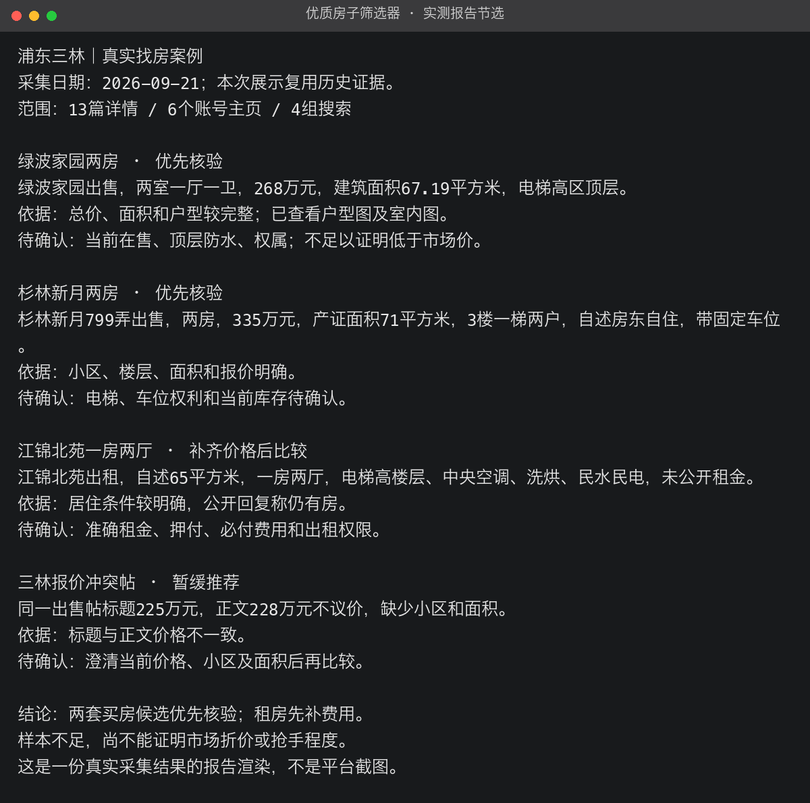

# 优质房子筛选器

在你想住的区域，帮你筛选**高质量、高性价比、值得及时关注的租房和买房房源**。

告诉它区域或小区、预算和居住要求，它会查看小红书房源、发布账号和历史帖子，比较房屋条件与报价，给出优先看哪几套、为什么、还有什么要确认。

## 使用场景

| 场景 | 你提供什么 | 帮你做什么 |
| --- | --- | --- |
| 区域租房 | 区域或小区、月租预算、户型、入住时间和居住要求 | 筛选品质好、费用合理、值得尽快了解的房源，列出优先看房清单 |
| 区域买房 | 区域或小区、总价预算、面积、户型及楼层要求 | 对比房屋品质和同类报价，找到值得重点关注的候选房源 |

## 真实使用案例：浦东三林找房

实际需求：**“筛选浦东三林最近两周的优质房源。”**

2026年9月21日，使用浏览器查看了13篇帖子详情、6个账号主页，完成4组搜索。用户当时没有限定租房或买房，因此分别整理了两类结果。

上图是实际采集结果整理成的报告文字渲染，不是小红书页面截图。以下为该次观察的结果，报价不代表今天仍有效。

| 房源 | 当时读到的信息 | 筛选结果 |
| --- | --- | --- |
| [绿波家园两房](https://www.xiaohongshu.com/explore/6aacf45b000000001203555e) | 268万元、建筑面积67.19㎡、电梯高区顶层 | 优先核验：总价和面积明确，已查看户型图及室内图；进一步确认在售状态、顶层防水和权属 |
| [杉林新月两房](https://www.xiaohongshu.com/explore/6ab08646000000002803b0dd) | 335万元、自述产证71㎡、3楼、带固定车位 | 优先核验：信息较完整；进一步确认电梯、车位权利和当前库存 |
| [江锦北苑一房两厅](https://www.xiaohongshu.com/explore/6aaab271000000002902f0c2) | 自述65㎡、电梯高楼层、中央空调、未公开租金 | 保留线索：先补准确租金和全部必付费用，再判断性价比 |
| [三林某出售帖](https://www.xiaohongshu.com/explore/6aaa650c0000000025036152) | 标题225万元，正文228万元不议价 | 暂缓推荐：先澄清价格冲突，并补小区和面积 |

这次筛选缩小了需要进一步了解的范围，也发现了报价冲突。由于同类样本不足、没有后续成交记录，**尚不能证明这些房源低于市场价或特别抢手**。

[查看完整案例、来源与限制](evals/sanlin-20260921/report.md)。案例来自历史真实采集；本次版本更新复用了已保存证据，没有重新确认房源仍可租售。原帖可能需要小红书登录或在 App 内查看。

## 两种使用模式

两种模式都输出房源对照清单，区别在于由谁完成第一轮文字分析。

| 模式 | 怎么分析 | 适合什么情况 |
| --- | --- | --- |
| **常规模式：不使用 Jev** | 当前 Agent 直接分析帖子、账号和图片，再比较品质与价格 | 直接开始找房，不想额外配置服务；默认使用此模式 |
| **Jev 模式** | Jev 先识别租售供需、报价是否明确、是否为多套房广告；当前 Agent 继续核实图片和证据，给出候选清单 | 已有 TypeSafe API Key，希望用低成本模型承担批量文字初筛 |

常规模式不需要 TypeSafe Key；当前 Agent 和采集服务仍按各自方式计费。Jev 模式会向 TypeSafe 发送必要的脱敏文字；缺少密钥或调用失败时，继续由当前 Agent 分析，并说明模式变化。

Jev 的初筛标签不会直接决定推荐或删除房源。真实性、当前是否可租售、是否符合你的要求，始终需要结合证据判断。

## 如何安装与使用

把[这个仓库](https://github.com/JuneYaooo/housing-quality-radar)交给支持 Skill 的 Agent，让它安装「优质房子筛选器」。本项目的技能标识是 `xiaohongshu-housing-radar`，已在 Codex 本地技能目录验证。手动安装和 Jev 配置见[使用文档](docs/usage.md)。

**租房，使用常规模式：**

> 使用优质房子筛选器，不使用 Jev。帮我找浦东三林最近两周的整租房，月租6000元以内，两室、有电梯、能养猫。优先筛选品质好、性价比高、值得尽快联系的房源，告诉我选择理由和原帖链接。

**买房，使用 Jev 模式：**

> 使用优质房子筛选器，使用 Jev 模式。帮我筛选浦东三林总价350万元以内的两房，重点看房屋品质和同类报价，列出值得优先了解的房源，以及判断依据和需要确认的问题。

支持通过浏览器读取可见房源，也支持你提供的帖子链接或材料。实际采集需要可用的数据入口；浏览器需要登录时，在正常页面完成登录即可。

## 你会得到什么

- **优先看房清单**：小区、户型、面积、报价、推荐理由和原帖链接。
- **品质与性价比对比**：楼层、电梯、装修、费用和你的居住要求逐项比较。
- **值得及时关注的线索**：近期发布、报价变化及有证据支持的供需变化；证据不足时明确说明。
- **待确认的问题**：例如当前是否还有房、完整租金费用、车位权利、转租权限。

多中介同时发帖可以作为关注线索，但不能直接证明抢手；长期重复出现也不能直接判假。同类有效报价不足时，会给逐套对照，不编造市场折价率。

## 实测与验证

三林案例是一次浏览器抽样实测，非区域全量搜索，也未做带看和权属核验。[采集范围与案例记录](evals/sanlin-20260921/metadata.json)

前期另用6条人工整理的真实房源文本测试 Jev：供需、报价、库存三类判断共18项符合预先标注，响应中位数约0.63秒，API费用按当日价格估算约 $0.000212。该测试包含一个后来删除的产权判断问题，**不是当前版本的性能承诺，也没有证明两种模式效果相同**。[实测数据](evals/jev-historical-summary.json) · [评测方法与限制](docs/evaluation.md)

当前版本另有两种模式的路由及异常处理测试，用于检查程序行为，不代表真实房源筛选准确率。[验证记录](evals/README.md)
