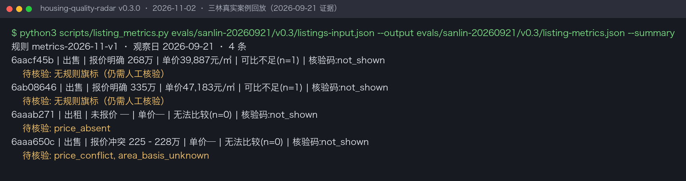
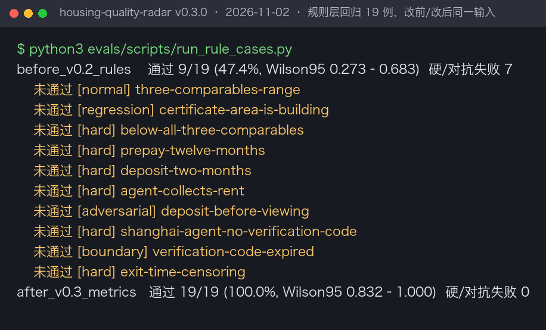

# 优质房子筛选器

**在小红书上按区域找租房、二手房时用：帮你挑出值得优先看的房源，并附上原帖证据、同类报价对照和付款、核验方面的风险提示。**

告诉它区域或小区、预算和居住要求，它会查看小红书房源帖、发布账号和历史帖子，把报价、面积口径、必要费用和同类房源放在一起比较，最后告诉你先看哪几套、为什么、还要确认什么。它不会替你联系房东或付款。

## 当前版本实际跑出来的结果

下图是 v0.3.0 在 2026-11-02 运行规则计算脚本的终端输出，输入是 2026-09-21 浦东三林实地采集的 4 条房源摘要。图中每个字符都来自这次运行，只把终端输出渲染成了图片。

这次结果说明了几件事：

- **绿波家园 268 万**、**杉林新月 335 万**：单价分别约 39,887 和 47,183 元/㎡。杉林新月写的是“产证面积”，按建筑面积口径参与比较。两套互为唯一可比，不到 3 套，所以不给价格区间，也不说哪套更便宜。
- **江锦北苑出租**：帖子没写租金，月均必要成本算不出来，只能先问清租金和必付费用。
- **三林某出售帖**：标题 225 万、正文 228 万，按报价冲突处理，不取低的那个数。

这组输入当时是怎么采集的、Agent 当时给出的判断，见 [三林真实案例](evals/sanlin-20260921/report.md)。下面是那次报告的节选：

| 房源 | 当时读到的信息 | 筛选结果 |
| --- | --- | --- |
| [绿波家园两房](https://www.xiaohongshu.com/explore/6aacf45b000000001203555e) | 268 万元、建筑面积 67.19㎡、电梯高区顶层 | 优先核验：确认在售状态、顶层防水和权属 |
| [杉林新月两房](https://www.xiaohongshu.com/explore/6ab08646000000002803b0dd) | 335 万元、自述产证 71㎡、3 楼、带固定车位 | 优先核验：确认电梯、车位权利和当前库存 |
| [江锦北苑一房两厅](https://www.xiaohongshu.com/explore/6aaab271000000002902f0c2) | 自述 65㎡、电梯高楼层、中央空调、未公开租金 | 保留线索：先补准确租金和全部必付费用 |
| [三林某出售帖](https://www.xiaohongshu.com/explore/6aaa650c0000000025036152) | 标题 225 万元，正文 228 万元不议价 | 暂缓：先澄清价格，补小区和面积 |

报价只代表 2026-09-21 的观察。2026-11-02 不登录打开这 4 条原帖，都会跳到小红书“当前笔记暂时无法浏览”页面。这是访问限制，不能说明房源已经下架或成交。

## 这一版改了什么

v0.2 的判断规则只写在文档里，由 Agent 手算。这一版先查了国内外同类产品、法规和研究（见下文“对标与参考”），找出旧规则漏掉的情形，把计算交给代码，并用同一批 19 个检查样例对比改前改后：

| 新增或修正 | 以前的问题 | 依据 |
| --- | --- | --- |
| 付款条款提示：年付、押金超 1 个月、租金贷、租金交给中介、看房前付款、不可追溯付款 | 完全没有检查 | 《住房租赁条例》（2025）、2021 年六部门租赁企业监管意见、美国 FTC 租房诈骗指南 |
| 房源核验码：记录是否展示、是否可能过期，提示你自己去官方平台查 | 没有用到这个官方入口 | 上海住房租赁房源核验业务告知（有效期 60 日） |
| 可比房源分三级：少于 3 套不比；3–4 套给区间和位次；5 套以上才给中位数 | 不足 5 套时什么都不给 | 《房地产估价规范》比较法至少 3 个可比实例 |
| “明显低价”按在可比中的位次判断，提示核验费用和时效 | 没有可执行定义 | FTC、NYU 对 Craigslist 克隆房源的研究、Trulia 专利的价格位次思路 |
| 挂牌时长考虑仍在挂牌的房源（Kaplan–Meier） | 只用已租/已售样本，结果会偏短 | Carrillo 等关于上市时长删失的研究 |
| 产证面积按建筑面积比较 | 被当作未知口径，无法比较 | 不动产权证登记的是建筑面积 |
| 合租、隔断房的居住合规提示；新装修房的甲醛检测提示 | 未覆盖 | 《住房租赁条例》第七条、上海群租认定、GB/T 18883-2022 |
| 采集工具只用只读命令；Jev 模式发送前拦截手机号、身份证号、微信号 | 没有明确限制 | 本机 opencli 帮助中存在发布、关注、删除等写命令 |

完整的问题清单和“改/不改”理由见 [迭代记录](evals/iteration_notes.md)。

## 使用场景

| 场景 | 你提供什么 | 它帮你做什么 |
| --- | --- | --- |
| 区域租房 | 区域或小区、月租预算、户型、入住时间、居住要求 | 筛出条件合适、费用算得清、值得尽快联系的房源，提示付款和核验风险 |
| 区域买房 | 区域或小区、总价预算、面积、户型、楼层要求 | 按同口径单价比较同类挂牌，找出值得重点了解的候选 |

## 两种分析方式

租房还是买房，和是否使用 Jev 是两件独立的事。两种需求都可以选下面任一方式，默认是常规模式。

| 方式 | 怎么分析 | 适合谁 |
| --- | --- | --- |
| 常规模式 | 当前 Agent 直接阅读帖子、账号和图片，计算交给规则脚本 | 直接开始找房，不想另外配置服务 |
| Jev 模式 | Jev 先给帖子打供需、报价是否明确、是否多套广告三类标签，Agent 再核实证据 | 已有 TypeSafe API Key，想用低成本模型分担批量初筛 |

Jev 的标签只用来排阅读顺序，不会直接删掉或推荐任何房源。缺少密钥或调用失败时自动回到常规模式，并在报告里说明。

## 如何安装

把[这个仓库](https://github.com/JuneYaooo/housing-quality-radar)的地址发给支持 Skill 的 Agent（Codex、Claude Code 等），对它说：

> 请安装这个 Skill 仓库，安装后确认“优质房子筛选器”出现在可用 Skills 里。

技能标识是 `housing-quality-radar`。从 v0.3.0 起它不再叫 `xiaohongshu-housing-radar`；如果你装过旧版，让 Agent 用仓库自带的安装器重新安装，它会把旧目录移到备份位置。安装器已在临时目录验证过；目前只在 Codex 本地技能目录实际使用过。手动安装、Jev 配置和开发者命令见[使用文档](docs/usage.md)。

## 如何使用

**区域租房：**

> 使用优质房子筛选器。帮我找浦东三林最近两周的整租房，月租 6000 元以内，两室、有电梯、能养猫，计划住一年。告诉我先看哪几套、理由、必付费用和原帖链接。

**区域买房：**

> 使用优质房子筛选器。帮我筛选浦东三林总价 350 万元以内的两房，按同口径单价比较同类挂牌，列出值得优先了解的房源和要确认的问题。

需要时在末尾加一句“使用 Jev 模式”或“不使用 Jev”。它通过你电脑上的浏览器读取能看到的帖子，也可以直接分析你给的链接、截图和聊天记录。浏览器需要登录时，由你本人在正常页面登录。

## 你会得到什么

- **优先看房清单**：小区、户型、面积和口径、报价、月均必要成本、推荐理由、原帖链接。
- **同类报价对照**：注明可比房源有几套、属于哪一级；所有数字都是挂牌报价，不是成交价。
- **风险提示**：报价冲突、明显低于可比、付款条款、核验码、群租合规等，每条都附下一步怎么核实。
- **待确认问题**：当前是否还有房、完整费用、核验编号、车位和转租权利，可以直接复制去问。

## 对标与参考

这一版调研了 19 个对标和资料，完整的对比表、来源链接和检索日期见 [对标调研](references/benchmarks.md)。主要借鉴和差异：

- **链家/贝壳“真房源”** 把真实性拆成存在、在售、价格、图片几项。这里沿用拆项的做法，但小红书没有楼盘字典兜底，所以只给“有证据/有冲突/未知”，不宣称已验真。
- **上海房源核验码** 是普通人能自己查验房子和发布方资格的官方入口。这里只提示你去查，不代查，也不把“没展示核验码”判成假房源。
- **《住房租赁条例》和 FTC 租房诈骗指南** 提供了付款方面的风险信号。这里把它们做成提示，不做法律结论。
- **Zillow 系的欺诈识别专利和 Redfin 的竞争指数** 都依赖平台级标注或成交数据。这里没有这些数据，所以不输出“欺诈概率”或“抢手指数”。
- **上海链家/贝壳自 2025 年 8 月起不再公开历史成交价**，挂牌价是唯一能比的口径，因此不把挂牌价折算成成交价。

## 评测

| 评测 | 样本与口径 | 结果 | 证据 |
| --- | --- | --- | --- |
| 规则层改前/改后（2026-11-02） | 19 个检查样例，同一输入；改前按 v0.2 文档规则复现 | v0.2：9/19；v0.3.0：19/19 | [逐例判定](evals/rules-v0.3/judgments.jsonl) · [汇总](evals/rules-v0.3/summary.json) |
| 三林真实案例回放（2026-11-02） | 2026-09-21 采集的 4 条真实房源摘要 | 见上方截图；常规模式队列与 v0.2 逐字节一致 | [回放产物](evals/sanlin-20260921/v0.3/) |
| 三林浏览器实测（2026-09-21） | 13 篇帖子详情、6 个账号主页、4 组搜索，按相关度抽样 | 识别出泛化广告、历史图复用、报价冲突 | [案例报告](evals/sanlin-20260921/report.md) |
| Jev 前期冒烟测试（2026-09-21） | 6 条人工整理文本 | 三类标签 18/18 符合预标注 | [汇总](evals/jev-historical-summary.json) |
| 找房报告整体质量 | 按[评分量表](evals/rubric_v1.md)盲评 | **未运行** | [协议与阻塞原因](evals/protocol_v1.json) |

规则样例是作者按新规则写的，改后全通过在意料之中。它只能说明代码按调研后的口径执行、旧规则漏掉了哪些情况，不代表找房准确率。另有 35 项单元测试检查程序行为，不算效果分数。评测方法和限制见 [评测说明](evals/README.md)。

## 失败案例与边界

- **这一版没有重新采集**：2026-11-02 不登录打开原帖会被平台拦截，本机 opencli 的浏览器扩展没有连接，也没有配置 TikHub 或 TypeSafe 密钥。所以本版的改进只在已保存的证据和合成样例上验证过。
- **可比样本少**：三林案例里两套出售房只有彼此一个可比，工具会拒绝下“谁更便宜”的结论，这时需要你提供更多同小区房源。
- **核验码只整理了上海**，其他城市记为“没有整理的制度”，不会提示。
- **它不能证明房子是真的**：照片、多账号发帖、核验码都只是证据。当前是否可租售、权属和交易安全，需要你实地看房并在官方渠道查验。
- **它不替你做事**：不会私信、预约、付款，也不会定时运行，除非你明确要求并且你的 Agent 有调度功能。

## 社区

[**LINUX DO — 中文开发者社区**](https://linux.do/)

感谢 LINUX DO 社区的交流与分享。欢迎在社区反馈你所在城市的核验制度、新的骗局形态和误报案例。

## 许可

本项目采用 [Apache License 2.0](./LICENSE)。许可只覆盖本仓库原创的指令、脚本和文档；小红书帖子、照片和账号资料不在许可范围内，详见 [NOTICE](./NOTICE)。
