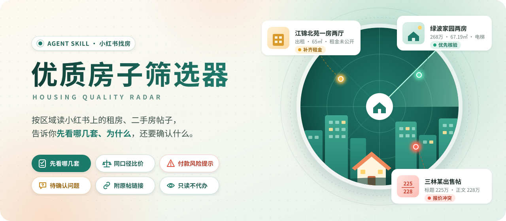

# 优质房子筛选器

**在小红书上按区域找租房、二手房时用：告诉你先看哪几套、为什么，以及还要确认什么。**

---

告诉它区域或小区、预算和居住要求，它会读小红书上的房源帖、发布账号和历史帖子，把报价、面积口径、必要费用和同类房源放在一起比较，最后交给你一份带原帖链接的找房清单。

它只读不写：不会替你私信、预约或付款。

## 效果展示

下面是一次真实找房的结果：2026-09-21 在浦东三林实地采集了 13 篇帖子、6 个账号主页和 4 组搜索，Agent 据此整理出的报告节选。

| 房源 | 帖子里的信息 | 筛选结论 |
| --- | --- | --- |
| [绿波家园两房](https://www.xiaohongshu.com/explore/6aacf45b000000001203555e) | 268 万元，建筑面积 67.19㎡，电梯高区顶层 | **优先核验**：在售状态、顶层防水、权属 |
| [杉林新月两房](https://www.xiaohongshu.com/explore/6ab08646000000002803b0dd) | 335 万元，产证 71㎡，3 楼，带固定车位 | **优先核验**：电梯、车位权利、当前库存 |
| [江锦北苑一房两厅](https://www.xiaohongshu.com/explore/6aaab271000000002902f0c2) | 自述 65㎡，电梯高楼层，未公开租金 | **保留线索**：先问清租金和必付费用 |
| [三林某出售帖](https://www.xiaohongshu.com/explore/6aaa650c0000000025036152) | 标题 225 万元，正文 228 万元 | **暂缓**：价格前后矛盾，先澄清 |

同一批房源交给规则计算，得到下面的结果（终端原样输出）：

两套出售房单价约 39,887 和 47,183 元/㎡，但同类可比只有彼此一套，所以它**不会**说哪套更便宜；报价冲突的帖子也不会取较低的那个数。样本不够时宁可少说，是它的默认做法。

> 报价只代表采集当天的观察。原帖现在不登录打开会被平台拦截，这不代表房源已经下架。完整过程见 [三林真实案例](evals/sanlin-20260921/report.md)。

## 它能做什么

- **筛出值得先看的房源**：按你的预算和要求排序，每套都写清理由和原帖链接。
- **同口径比价**：统一面积口径，算单价和月均必要成本；同类房源不足 3 套时不比较，3–4 套给区间，5 套以上才给中位数。
- **识别可疑信号**：标题正文报价冲突、明显低于同类、一个账号发很多套、图片复用等。
- **提示付款与核验风险**：年付、押金超过 1 个月、租金贷、看房前付款、转个人账户；提醒你索要房源核验码并自己去官方平台查。
- **列出待确认问题**：是否还有房、完整费用、核验编号、车位和转租权利，可以直接复制去问。

## 适合谁

| 场景 | 你提供什么 | 你会得到什么 |
| --- | --- | --- |
| 区域租房 | 区域或小区、月租预算、户型、入住时间 | 条件合适、费用算得清的房源，以及付款和核验提醒 |
| 区域买房 | 区域或小区、总价预算、面积、楼层要求 | 同口径单价对照，值得重点了解的候选 |
| 已有几条帖子拿不准 | 链接、截图或和中介的聊天记录 | 逐条拆出报价、口径和疑点，告诉你还缺什么信息 |

默认由当前 Agent 直接阅读分析。帖子很多时，可以说一句“使用 Jev 模式”，让低成本模型先帮忙排阅读顺序；它只排序，不替你删掉任何房源。

## 如何安装

把[这个仓库](https://github.com/JuneYaooo/housing-quality-radar)的地址发给支持 Skill 的 Agent（Codex、Claude Code 等），对它说：

> 请安装这个 Skill 仓库，安装后确认“优质房子筛选器”出现在可用 Skills 里。

装好后重新打开会话即可。手动安装、Jev 配置等见 [使用文档](docs/usage.md)。

## 如何使用

直接用自然语言说需求：

> 使用优质房子筛选器。帮我找浦东三林最近两周的整租房，月租 6000 元以内，两室、有电梯、能养猫，计划住一年。告诉我先看哪几套、理由、必付费用和原帖链接。

> 使用优质房子筛选器。帮我筛选浦东三林总价 350 万元以内的两房，按同口径单价比较，列出值得优先了解的房源和要确认的问题。

> 这三条小红书帖子是同一个中介发的，帮我看看报价和面积有没有问题，看房前要问什么。

它通过你电脑上的浏览器读取你能看到的帖子。需要登录时，由你本人在正常页面登录。

## 对标与参考

| 参考 | 借鉴了什么 | 这里的做法 |
| --- | --- | --- |
| 链家/贝壳“真房源” | 把真实性拆成存在、在售、价格、图片几项 | 只给“有证据 / 有冲突 / 未知”，不宣称已验真 |
| 上海房源核验码 | 普通人能自己查验房源的官方入口 | 提示你去查，不代查 |
| 《住房租赁条例》、FTC 租房诈骗指南 | 付款方式和付款时机的风险信号 | 做成提示，不下法律结论 |
| 《房地产估价规范》比较法 | 至少 3 个可比实例才能比较 | 可比不足就不比价 |

完整对标与来源见 [对标调研](references/benchmarks.md)。

## 效果怎么验证

规则计算有一组固定检查样例，真实案例的输入、输出和报告都保存在仓库里，可以复跑核对。方法、口径和仍未完成的评测见 [评测说明](evals/README.md)。

## 边界与注意事项

- **它不能证明房子是真的**：照片、账号和核验码都只是证据，在售状态、权属和交易安全要靠实地看房和官方渠道。
- **报价不等于成交价**：所有比较都基于挂牌报价，不会折算成“预计成交价”。
- **受平台访问限制**：能读到多少帖子取决于你的浏览器登录状态和小红书的限制。
- **核验码规则目前只整理了上海**，其他城市不会提示。
- **隐私**：数据保存在你本地；使用 Jev 模式时，含手机号、身份证号、微信号的文本不会发出。

## 社区

[**LINUX DO — 中文开发者社区**](https://linux.do/)

感谢 LINUX DO 社区的交流与分享。欢迎反馈你所在城市的核验制度、新的骗局形态和误报案例。

## 许可

本项目采用 [Apache License 2.0](./LICENSE)。许可只覆盖本仓库原创的指令、脚本和文档；小红书帖子、照片和账号资料不在许可范围内，详见 [NOTICE](./NOTICE)。
