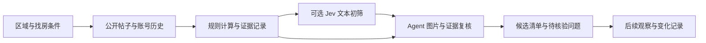

# 优质房子筛选器 · Housing Quality Radar

把小红书上的租售帖子，整理成**有证据、可对照、值得进一步核验的房源清单**。

指定区域或小区，Agent 先看发布账号与区域样本，再识别重复房源、比较条件和报价、追踪后续变化。规则代码负责计算，Jev 可选承担低成本文本初筛，Agent 负责图片、冲突和证据复核。最终告诉你：为什么值得看、还有什么没核实、下一步该问什么。

这是可安装到 Agent 的 Skill，包含一个可选的 Jev 初筛脚本；使用宿主已有的浏览器或采集入口，没有独立找房网站或内置全量数据库。

## 使用场景

| 场景 | 你提供什么 | 得到什么 |
| --- | --- | --- |
| 区域租房 | 区域、预算、整租/合租、入住时间 | 候选清单、完整费用缺项、当前可租状态待核验项 |
| 重点小区买房 | 小区、总价、户型、电梯等要求 | 同口径报价对照、楼层装修差异、来源证据 |
| 怀疑重复引流 | 帖子或账号链接 | 历史曝光、素材复用、字段冲突与核验问题 |
| 持续关注 | 已保存的条件与观察记录 | 新候选、价格或状态变化；需另行启用宿主调度 |

## 它解决什么问题

同一套房可能被多个中介转发，旧帖子可能只刷新编辑时间，精美图片也可能是公寓样板间。仅看发布频次、低价或照片，无法判断是否真实、可租售或适合自己。

本工具把**实物存在、信息一致、当前可租售、发布者权限**分开判断。多账号传播不自动等于独立背书；长期曝光不直接判假；只有三套可比房时不会伪造市场中位价。



**合成示例，非真实房源推荐：**

| 输入 | 筛选结果 |
| --- | --- |
| “3300元起，32–40㎡，部分房源通燃气” | 泛化库存广告；数字不等于具体图片对应房源的确定报价 |
| “旧帖6800元，新帖同图但未报价” | 当前价格待确认；不能把旧报价作为现价 |
| “自称房东，产权干净” | 发布者自述；权限仍待独立核验 |
| 同门店8个账号同期发同图 | 多账号传播；独立来源不能计为8个 |

## 能力与边界

| 能力 | 边界 |
| --- | --- |
| 按区域、小区、账号采集并保留短摘录和来源 | 需要可用的宿主入口、登录状态和可见页面；不保证完整覆盖 |
| 分析个人/中介/机构身份及来源关联 | 账号角色是有依据的推断，不是房东权属验证 |
| 聚合同一房源、追踪报价与曝光历史 | 同图可能只是同素材；删除或搜不到不等于成交 |
| 品质、用户适配与横向价格对比 | 未知保持未知；至少5套有效可比房才给分位统计 |
| 可选 Jev 判断供需、报价披露和单套/泛化库存 | 默认 shadow 模式保留所有输入，不输出真假概率或自动推荐 |
| 历史记录支持持续监控 | 安装 Skill 不会启动后台任务，也不会自动私信或预约 |

## 如何安装与使用

Skill 的稳定标识保留为 `xiaohongshu-housing-radar`，仓库与展示名使用「优质房子筛选器」。以 Codex 个人技能目录为例：

```bash
 git clone https://github.com/JuneYaooo/housing-quality-radar.git \
   ~/.codex/skills/xiaohongshu-housing-radar
```

已有同名安装时更新原目录，避免直接覆盖自己的改动。其他 Agent 按其支持的 Skill 目录放置本仓库。

对 Agent 说：

> 使用 $xiaohongshu-housing-radar，筛选浦东三林近两周整租房源，月预算6000元，两室、电梯、能养猫。先查看账号历史，列出值得核验的房源、价格缺项和原帖链接。

首次运行会保存条件和观察记录到用户工作目录 `housing-radar/<watch_id>/`。数据源顺序参考 [social-account-doctor](https://github.com/JuneYaooo/social-account-doctor)：电脑操控 → 宿主浏览器 → opencli → TikHub REST → MediaCrawler；用户指定入口优先，成功后不为同一字段重复付费取数。外部适配器需另行安装，详见[来源适配](references/source-adapters.md)。

### 可选 Jev 初筛

Python 3.10+，仅使用标准库。先跑无需密钥、无需网络的示例：

```bash
python3 scripts/triage.py examples/triage-input.jsonl --output runs/offline.jsonl
```

使用 Jev 时，把 `TYPESAFE_API_KEY` 配置到运行环境，并在监控配置启用 `decision_pipeline.jev.enabled`。Agent 先将必要文本脱敏，再执行：

```bash
python3 scripts/triage.py /absolute/path/redacted-input.jsonl \
  --output /absolute/path/new-triage.jsonl --enable-jev --max-requests 20
```

开启后会把输入的 `text` 发送给 TypeSafe；脚本不自动脱敏。密钥不写入仓库或输出。未启用、缺密钥、超限或请求失败均保留候选交给 Agent；详情见[分层决策说明](references/decision-pipeline.md)。

## 评测结果

2026-09-21 的前期 Jev 冒烟实测：6条人工整理的中文房源文本，18项供需/报价/库存分类符合预先标注；API 响应中位数0.63秒，5051输入 tokens，按当日官方价格估算共 $0.000212。实际返回模型 `jev-1.13.0`。

**这不是独立准确率基准，也没有证明同等效果下全流程更快。** 前期另测的“产权已核验”Noul 问题在没有独立证据时出现0.56分值，因此正式脚本删除该问题，权属仍由证据复核。当前脚本只保留三个 Choice，前述费用与耗时来自原四问题测试，不能作为当前脚本的精确性能结果。

当前版本的自动化验证覆盖：无密钥降级、限额保留、失败停止、异常响应、低置信转复核，以及高置信不会变成“真实性已核验”。运行：

```bash
python3 -m unittest discover -s tests -v
```

[评测记录与限制](docs/evaluation.md)区分真实 API 冒烟测试、浏览器采集试运行与模拟响应测试。真实房源、账号记录、登录参数及私人配置不随仓库发布。

## 对标与定位

参考 [social-account-doctor](https://github.com/JuneYaooo/social-account-doctor) 的数据入口设计，将分析目标改为房源证据、时间线和可比报价；未复制其采集程序，不以内容热度给房源打分。

Jev 适合承担低成本、结构明确的文本问题；证据不足、图片比较和最终推荐由 Agent 复核。日期、金额等确定性处理无需模型。是否更省取决于复核率和采集成本，需用保留评测集做同条件对照。[TypeSafe 官方说明](https://docs.typesafe.ai/introduction)

## 社区与许可

- 问题与改进建议：[GitHub Issues](https://github.com/JuneYaooo/housing-quality-radar/issues)
- 许可证：[Apache License 2.0](LICENSE)
- 外部服务与数据来源说明：[NOTICE](NOTICE)
